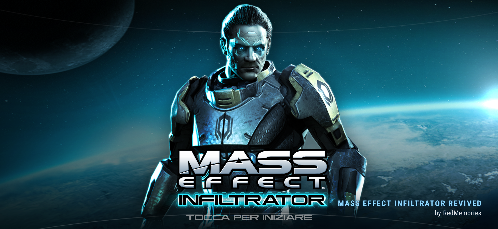
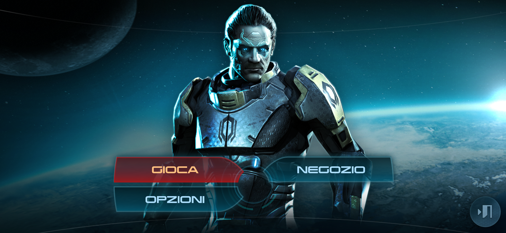
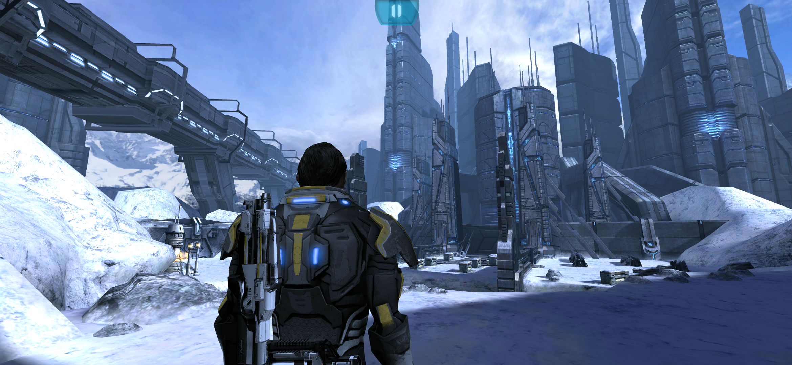
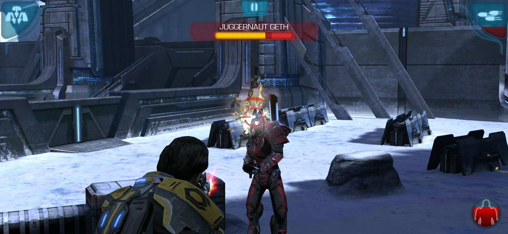
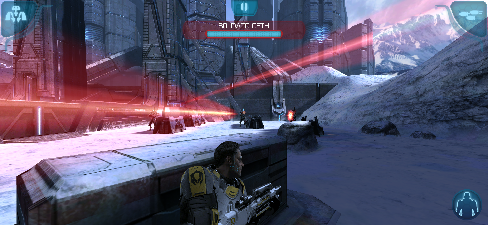

# Mass Effect Infiltrator Revived

> Mass Effect is a trademark of Electronic Arts. This is a non-commercial fan project, not affiliated with EA or BioWare. The game was pulled from the stores years ago. This repo is my private archive, please don't share the release files.

## What I did

I didn't remake the game and I didn't touch the gameplay. The original engine runs inside a new 64-bit app that translates its old code on the fly, so levels, combat and story are exactly the ones from 2012.

Once it was running, I gave it the treatment it deserves on a modern phone:

- full screen on today's tall displays, no more black bars on the sides
- native resolution with 4x anti-aliasing, so edges are clean instead of jagged
- 32-bit color instead of the original 16-bit, the skies and the snow don't have banding anymore
- sharper textures, especially floors and walls seen at an angle
- a steady 60 fps

I also cleaned up everything that was left over from EA's online stuff. The game is now fully offline, with no ads and no tracking, and it doesn't ask for any permission. The buttons that sent you to the Play Store or to services that don't exist anymore (More EA Games, Galaxy at War, Info) are gone, and so are the update checks and the EA popups. The in-game store is still there and works with the credits you earn while playing.

The game data is packed inside the APK, so there's nothing to download separately.

## Install

1. Download the APK from **Releases**
2. Install it
3. Open it. The first launch takes a few seconds to unpack the game, after that it starts right away

No PC, no extra downloads, no account.

## Requirements

- 64-bit Android phone with Android 10 or newer
- about 1.2 GB of free space

I play it on a Galaxy S26 Ultra with Android 16.

Since 1.2 it also works on phones without a Snapdragon chip (MediaTek Dimensity, Exynos, Google Tensor). The game's textures use a format only Snapdragon GPUs can read, so on those phones they are now decoded when the game loads them. If you play on one of them, let me know how it runs.

## PC version

The game now runs on Windows as well, using the same original 2012 engine. Its ARM code is translated to x86-64 on the fly, rendering goes through Direct3D 11, and the Android layer the game depends on was reimplemented natively, so it runs as a regular Windows program with no emulator and no Android underneath.

**Controller support.** Xbox controllers work out of the box: left stick to move, right stick to aim, buttons for cover, biotic powers, cloak and melee, and full menu navigation. The game already contained gamepad controls from its Xperia Play version; the PC build connects them to the controller.

Keyboard and mouse are supported too, with WASD to move and the mouse to aim, while menus use a regular cursor. The game runs full screen at the monitor's native resolution at a steady 60 fps, with the same offline cleanup as the Android version.

Requirements: Windows 10 or 11 (64-bit) and a DirectX 11 graphics card.

## Credits

Revived by **RedMemories**

Thanks to the [dynarmic](https://github.com/azahar-emu/dynarmic) project, which makes running the old engine possible, and to [ANGLE](https://chromium.googlesource.com/angle/angle) and [SDL](https://www.libsdl.org/) for the PC version.

Original game by IronMonkey Studios and Electronic Arts.
